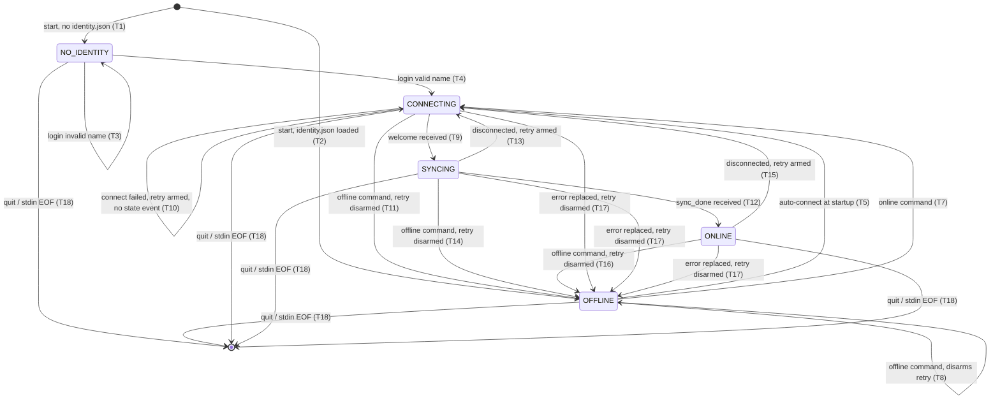

# Core Spec: Client Behavior

Status: normative. Protocol version: `v1`.

This document defines the client state machine, identity, outbox, inbound handling,
reconnection, and on-disk persistence. It is **platform-neutral**. The observable
stdin/stdout interface is defined in [cli-contract.md](cli-contract.md); the wire is
defined in [protocol.md](protocol.md).

RFC 2119 keywords apply. Every normative statement carries a stable ID.

`<data-dir>` is the directory given by `--data-dir` (REQ-CLI-001).

---

## 1. State machine — `REQ-STATE`

Five states, exactly these names, uppercase, used verbatim in `state` and `ready`
events (REQ-EVENT-004):

| State | Meaning |
| --- | --- |
| `NO_IDENTITY` | No identity yet; awaiting `login`. Start state only. |
| `OFFLINE` | Not connected and **not** trying: before the first connect attempt, after manual `offline`, or after `replaced`. |
| `CONNECTING` | Actively trying to establish a session — **including the 1 s gaps between retry attempts**. |
| `SYNCING` | `welcome` received; replaying held messages; outbox not yet flushed. |
| `ONLINE` | `sync_done` received; sends transmit immediately. |



- **REQ-STATE-001** The client MUST be in exactly one of the five states at all times,
  and MUST make only the transitions listed in REQ-STATE-004. Any other transition is a
  defect. `CONNECTING` covers the entire period in which the client is attempting to
  establish a session, including the intervals between retry attempts
  (REQ-RECONNECT-002); a failed attempt does not leave `CONNECTING`.
- **REQ-STATE-002** The client MUST emit `state{from,to}` (REQ-EVENT-004) on every
  transition where `from` differs from `to`, immediately after the transition takes
  effect and before any event caused by the new state.
- **REQ-STATE-003** A transition whose `from` equals its `to` (T3, T6, T8, T10) MUST NOT
  emit a `state` event. Retrying a connection is therefore silent on stdout, so the event
  stream stays bounded while the server is unreachable (REQ-RECONNECT-009).
- **REQ-STATE-004** The complete transition table. "Retry" is the auto-reconnect arming
  flag of REQ-RECONNECT-001.

  | # | From | Trigger | To | Actions and emitted events |
  | --- | --- | --- | --- | --- |
  | T1 | *(start)* | no readable `identity.json` | `NO_IDENTITY` | emit `ready{state:"NO_IDENTITY"}` |
  | T2 | *(start)* | `identity.json` loaded | `OFFLINE` | emit `ready{state:"OFFLINE"}`, then `logged_in{name}`; arm retry; then T5 |
  | T3 | `NO_IDENTITY` | `login` with invalid name | `NO_IDENTITY` | emit `error{code:"bad_name"}`; no persistence; no `state` event |
  | T4 | `NO_IDENTITY` | `login` with valid name | `CONNECTING` | persist identity (REQ-IDENTITY-002); emit `logged_in{name}`; arm retry; emit `state` |
  | T5 | `OFFLINE` | startup auto-connect | `CONNECTING` | open WebSocket; emit `state` |
  | T6 | `CONNECTING` | retry timer fires | `CONNECTING` | begin the next connect attempt; **no `state` event** |
  | T7 | `OFFLINE` | `online` command | `CONNECTING` | arm retry; attempt immediately (REQ-RECONNECT-005); emit `state` |
  | T8 | `OFFLINE` | `offline` command | `OFFLINE` | disarm retry; no `state` event |
  | T9 | `CONNECTING` | `welcome` received | `SYNCING` | emit `state` |
  | T10 | `CONNECTING` | connect failed, or closed before `welcome`, retry armed | `CONNECTING` | schedule the next attempt 1 s out (REQ-RECONNECT-003); **no `state` event, no `error` event** |
  | T11 | `CONNECTING` | `offline` command | `OFFLINE` | abort the attempt; disarm retry; emit `state` |
  | T12 | `SYNCING` | `sync_done` received | `ONLINE` | emit `state`, then flush outbox (REQ-FLUSH-001) |
  | T13 | `SYNCING` | connection closed, retry armed | `CONNECTING` | emit `state`; then retry per T10/T6 |
  | T14 | `SYNCING` | `offline` command | `OFFLINE` | close connection; disarm retry; emit `state` |
  | T15 | `ONLINE` | connection closed unexpectedly, retry armed | `CONNECTING` | emit `state`; then retry per T10/T6 |
  | T16 | `ONLINE` | `offline` command | `OFFLINE` | close connection; disarm retry; emit `state` |
  | T17 | `CONNECTING`/`SYNCING`/`ONLINE` | `error{code:"replaced"}` received | `OFFLINE` | emit `error{code:"replaced"}`; **disarm** retry (REQ-RECONNECT-006); emit `state` |
  | T18 | any | `quit` command or stdin EOF | *(exit)* | close connection; exit 0 (REQ-CMD-008); no `state` event |

  A connectivity loss therefore produces **exactly one** `state` event — the transition
  into `CONNECTING` (T13, T15) — however long the server stays down.

- **REQ-STATE-005** `NO_IDENTITY` is reachable only as a start state. Once an identity
  exists the client MUST NOT return to `NO_IDENTITY` for the lifetime of the process.
- **REQ-STATE-006** A `send` issued in `NO_IDENTITY` MUST be rejected with
  `error{code:"not_logged_in"}`; it MUST NOT be queued and MUST NOT emit `queued`. This
  is the only outcome for a `send` before an identity exists.
- **REQ-STATE-007** A `send` issued in `OFFLINE`, `CONNECTING`, or `SYNCING` MUST be
  queued (REQ-OUTBOX-003) and MUST NOT be transmitted. The client MUST NOT emit an error
  for the deferral; it is normal operation, not a failure.
- **REQ-STATE-008** The client MUST process state changes and stdin commands on a single
  logical timeline, so the stdout event stream is a deterministic serialisation of them
  (REQ-STDIO-008).

## 2. Identity — `REQ-IDENTITY`

- **REQ-IDENTITY-001** The client MUST have an identity before it may connect or send.
  On first launch with no stored identity it MUST start in `NO_IDENTITY` and wait for
  `login <name>`.
- **REQ-IDENTITY-002** On a valid `login <name>` the client MUST persist the identity to
  `<data-dir>/identity.json` using the atomic write of REQ-PERSIST-002, **before**
  emitting `logged_in` and before any network attempt. File schema — `v` MUST be `1` and
  `name` MUST satisfy REQ-NAME-001; a stored file violating either is corrupt state
  (REQ-PERSIST-004):

  ```json
  {"v": 1, "name": "alice"}
  ```

- **REQ-IDENTITY-003** `name` MUST be validated against REQ-NAME-001 **locally**, before
  persistence. An invalid name MUST produce `error{code:"bad_name"}` and MUST NOT be
  persisted, and MUST NOT reach the network (T3).
- **REQ-IDENTITY-004** On every later launch, if `<data-dir>/identity.json` exists and is
  valid, the client MUST load it, MUST NOT require `login`, MUST emit `logged_in{name}`,
  and MUST connect automatically (T2 then T5).
- **REQ-IDENTITY-005** Identity is immutable for the lifetime of a data directory. A
  `login` issued when an identity already exists MUST produce
  `error{code:"already_logged_in"}` and MUST change nothing — including when the name
  given is identical to the stored one.

## 3. Outbox — `REQ-OUTBOX`

The outbox is the durability guarantee: once the client has emitted `queued`, the message
is the client's responsibility until the server acks it.

- **REQ-OUTBOX-001** The client MUST maintain a persistent FIFO queue at
  `<data-dir>/outbox.json`. Its order is the order in which the user issued the `send`
  commands, and MUST be preserved across restarts.
- **REQ-OUTBOX-002** Every user `send` MUST be appended to the outbox and **durably
  written before any network attempt**. The client MUST NOT transmit a message that is not
  already on disk.
- **REQ-OUTBOX-003** The ordered steps for a `send` in a state that permits queueing are
  exactly: (1) validate `to` and `text` locally (REQ-OUTBOX-012); (2) generate the id
  (REQ-MSGID-002); (3) append and durably write the outbox (REQ-OUTBOX-002); (4) emit
  `queued{id,to,text}`; (5) transmit if and only if the state is `ONLINE`
  (REQ-FLUSH-004, REQ-STATE-007).
- **REQ-OUTBOX-004** An entry MUST be removed from the outbox **only** on receiving
  `ack{id}` for it, or on a permanent rejection (REQ-OUTBOX-009). It MUST NOT be removed
  on transmission, flush, disconnect, reconnect, restart, `offline`, or `quit`. The
  outbox MUST NOT be bounded or trimmed in `v1`, and the client MUST NOT drop an entry
  for capacity reasons.
- **REQ-OUTBOX-005** On `ack{id}` for an entry present in the outbox, the client MUST, in
  order: remove the entry, durably write the outbox (REQ-PERSIST-002), then emit
  `sent{id}`. `sent` MUST be emitted at most once per id per process lifetime.
- **REQ-OUTBOX-006** `ack{id}` for an id not in the outbox MUST be ignored: no `sent`
  event, no error, no state change. This covers duplicate acks arising from
  REQ-DEDUP-002.
- **REQ-OUTBOX-008** On launch the client MUST load the outbox from disk. Entries present
  there are live and MUST be flushed per REQ-FLUSH-002; the client MUST NOT emit `queued`
  for entries restored from disk.
- **REQ-OUTBOX-009** On a permanent rejection (REQ-ERR-005) whose `ref_id` matches an
  outbox entry, the client MUST remove that entry, durably write the outbox, and emit
  `error{code,message,ref_id:<id>}` carrying the server's code and **the dropped entry's
  message id**, so that the drop is observable and attributable. It MUST NOT emit
  `sent{id}`. A dropped entry MUST NOT be silently discarded.
- **REQ-OUTBOX-010** On a non-permanent error (REQ-ERR-006) the client MUST leave the
  entry in the outbox for retry, and MUST emit `error{code,message,ref_id:<id>}` when the
  server's error carried a `ref_id`.
- **REQ-OUTBOX-012** `to` and `text` MUST be validated locally against REQ-NAME-001 and
  REQ-TEXT-001 before queueing. A violation MUST produce `error{code:"bad_name"}` or
  `error{code:"bad_text"}` respectively, MUST NOT create an entry, MUST NOT consume an id,
  and MUST NOT emit `queued`. Because no id exists, that `error` carries no `ref_id`.
- **REQ-OUTBOX-013** `outbox.json` schema — a JSON object with a version and an ordered
  array; array order **is** queue order:

  ```json
  {"v": 1, "entries": [
    {"id": "7b1f9a3c-...", "to": "bob", "text": "hi"}
  ]}
  ```

## 4. Flush — `REQ-FLUSH`

- **REQ-FLUSH-001** The client MUST flush the outbox only after receiving `sync_done`
  (REQ-SYNC-008), immediately on entering `ONLINE` (T12).
- **REQ-FLUSH-002** A flush MUST transmit every outbox entry, in FIFO order, each as a
  `send` frame carrying the entry's original `id`, `to`, and `text`.
- **REQ-FLUSH-003** Entries already transmitted but not yet acked MUST be re-sent, with
  the **same id**, after every reconnect. Flushing is therefore idempotent and
  repeatable: running it on every reconnect with unchanged outbox contents MUST be
  correct, which rests on server-side dedup (REQ-DEDUP-002).
- **REQ-FLUSH-004** While `ONLINE`, a new `send` MUST be appended to the outbox
  (REQ-OUTBOX-003) and then transmitted immediately; the client MUST NOT wait for a
  reconnect, timer, or batch boundary.
- **REQ-FLUSH-006** The client MUST NOT reorder the outbox. A `send` issued during a
  flush is appended at the tail and therefore transmitted after the flushed entries.

## 5. Inbound messages — `REQ-INBOUND`

- **REQ-INBOUND-001** On receiving `msg{id,from,to,text,server_ts}` the client MUST reply
  `delivered{id}`, for both first-seen and duplicate messages (REQ-SNF-005 requires it to
  release the server's copy).
- **REQ-INBOUND-002** The client MUST deduplicate inbound messages by `id`, persisting
  seen ids in `<data-dir>/seen.json` so dedup survives restarts.
- **REQ-INBOUND-003** For a **first-seen** `msg` the ordered steps are exactly: (1) add
  `id` to the seen set and durably write `seen.json`; (2) emit `received{id,from,text}`;
  (3) send `delivered{id}`. Persisting before confirming prevents a crash between the two
  from redisplaying the message.
- **REQ-INBOUND-004** For a **duplicate** `msg` — an id already in the seen set — the
  client MUST send `delivered{id}` and MUST NOT emit `received` again, MUST NOT rewrite
  the seen set, and MUST NOT treat it as an error.
- **REQ-INBOUND-005** The client MUST emit `received` events in the order the `msg`
  frames arrived. It MUST NOT reorder by `server_ts`, by `id`, or by sender
  (REQ-TIME-004).
- **REQ-INBOUND-006** The client MUST NOT evict entries from the seen set in `v1`. No
  eviction policy may reintroduce a duplicate display.
- **REQ-INBOUND-007** A `msg` whose `to` differs from the client's own name MUST still be
  handled per REQ-INBOUND-003: `to` is informational and the client MUST NOT filter on it.
- **REQ-INBOUND-008** `seen.json` schema — array order is not significant:

  ```json
  {"v": 1, "seen": ["7b1f9a3c-...", "9c22b1de-..."]}
  ```

## 6. Reconnection — `REQ-RECONNECT`

- **REQ-RECONNECT-001** The client MUST maintain an **auto-reconnect armed** flag. It is
  armed when an identity is established (T2, T4) and by `online` (T7); it is disarmed by
  `offline` (T8, T11, T14, T16) and by `replaced` (T17). While the flag is disarmed the
  client MUST NOT attempt any connection; only `online` resumes connecting.
- **REQ-RECONNECT-002** After a failed connect attempt or an unexpected disconnect, with
  the flag armed, the client MUST retry the connection every **1 second** until it
  reaches `ONLINE` or the flag is disarmed, **remaining in `CONNECTING` throughout**
  (T6, T10). The interval is fixed: no exponential backoff, no jitter, no cap on
  attempts.
- **REQ-RECONNECT-003** The 1 second interval is measured from the end of the previous
  attempt — the connect failure or the disconnect — to the start of the next attempt.
- **REQ-RECONNECT-005** `online` MUST arm the flag and attempt a connection
  **immediately**, without waiting out the 1 second interval (T7).
- **REQ-RECONNECT-006** On `error{code:"replaced"}` the client MUST disarm the flag and
  go to `OFFLINE` (T17). It MUST NOT reconnect until an explicit `online`; automatic
  reconnection here would make two clients evict each other indefinitely
  (REQ-SESSION-002).
- **REQ-RECONNECT-007** Every reconnection MUST repeat the full handshake of §9 of the
  protocol: `hello`, `welcome`, replay, `sync_done`, then flush.
- **REQ-RECONNECT-008** Reconnection MUST NOT clear, reorder, or rewrite the outbox, the
  seen set, or the identity.
- **REQ-RECONNECT-009** A connect failure or retry attempt MUST NOT emit an `error` event
  and MUST NOT emit a `state` event (T6, T10). The only `state` event for a connectivity
  loss is the single transition into `CONNECTING` (T13, T15). Human-readable detail MAY
  go to stderr (REQ-STDIO-005). This bounds stdout while the server is down: a client
  retrying for an hour emits no events for it.

## 7. Test hooks — `REQ-TESTHOOK`

- **REQ-TESTHOOK-001** `offline` and `online` are **test hooks** that simulate network
  loss and recovery. They exist so conformance tests can exercise store-and-forward
  deterministically, without controlling the real network.
- **REQ-TESTHOOK-002** `offline` MUST close the WebSocket connection immediately and MUST
  disarm auto-reconnect. After it, the client MUST NOT transmit any frame until it is
  `ONLINE` again. (`online` resumes connecting per REQ-RECONNECT-005.)
- **REQ-TESTHOOK-004** `offline` while already `OFFLINE` or `NO_IDENTITY` MUST be
  accepted as a no-op that disarms the flag: no `state` event, no error (T8).
- **REQ-TESTHOOK-005** `online` while `CONNECTING`, `SYNCING`, or `ONLINE` MUST be
  accepted as a no-op that arms the flag: no `state` event, no error, and the existing
  connection or attempt MUST NOT be disturbed.
- **REQ-TESTHOOK-006** Neither hook may alter persistent state. The outbox, seen set, and
  identity MUST be byte-identical across an `offline`/`online` cycle that transmits
  nothing.
- **REQ-TESTHOOK-007** `offline` and `online` are the only network-simulation hooks in
  `v1`. The client MUST NOT offer additional hidden commands, environment switches, or
  debug modes that change observable behavior.

## 8. Persistence — `REQ-PERSIST`

- **REQ-PERSIST-001** All client state lives in exactly three files inside `<data-dir>`:
  `identity.json` (REQ-IDENTITY-002), `outbox.json` (REQ-OUTBOX-013), and `seen.json`
  (REQ-INBOUND-008). The client MUST NOT write any other persistent file, and MUST NOT
  write outside `<data-dir>`.
- **REQ-PERSIST-002** Every write to these files MUST be **atomic**: serialise the full
  new contents to a temporary file in the same directory, flush it to durable storage,
  then rename it over the target path. The client MUST NOT modify a live file in place,
  MUST NOT truncate-then-write, and MUST NOT append.
- **REQ-PERSIST-003** All three files MUST be UTF-8 encoded JSON objects carrying
  `"v": 1`. A missing file MUST be read as empty state (no identity / empty outbox / empty
  seen set) and MUST NOT be an error.
- **REQ-PERSIST-004** A file that exists but is unreadable, is not valid JSON, or fails
  its schema is **corrupt state**: the client MUST emit
  `error{code:"corrupt_state",message}` and exit with status `2` (REQ-CLI-006). It MUST
  NOT delete, truncate, overwrite, or silently reset the file; losing queued messages
  silently is worse than refusing to start.
- **REQ-PERSIST-005** The client MUST create `<data-dir>` if it does not exist, including
  missing parent directories.
- **REQ-PERSIST-006** Two clients using different data directories MUST be fully
  independent: no shared files, no shared global or user-level state, no fixed temporary
  paths. Several clients MUST be runnable concurrently on one machine.
- **REQ-PERSIST-007** Concurrent use of one `<data-dir>` by two processes is unsupported
  in `v1`; behavior is undefined and the client is not required to detect it.
- **REQ-PERSIST-008** On every launch the client MUST load all three files before
  emitting `ready` (REQ-EVENT-002), so `ready.state` reflects the persisted state.

